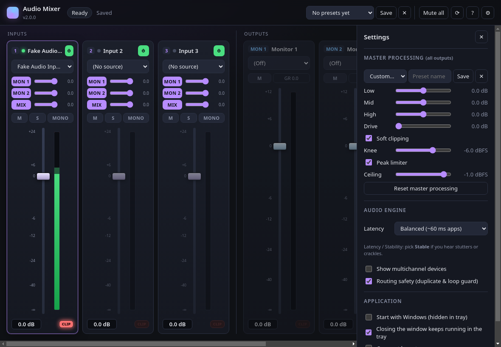

# Luna's Audio Mixer

> Heads up: I turned this into vibecoded crap for better performance. Honestly I don't really care about it much anymore, I originally made it for an ex who hated Voicemeeter.

A low-latency desktop mixer for Windows. Capture microphones, line inputs **or individual applications**, mix them on channel strips and route the result to up to three output devices (e.g. headphones, speakers and a virtual cable for streaming).

Version 2 runs on **Tauri** with the whole audio engine in **Rust** (WASAPI capture, process loopback and render, 32-bit float mixing). The UI is the same web UI as before, shown in WebView2.



## Features

**Inputs (3 channel strips)**
- Source: any capture device **or a running application** (per-app capture via Windows WASAPI process loopback).
- Gain fader in dB, from -∞ to **+24 dB**.
- Mute, Solo, Mono sum, Enable.
- **DUMP** (app inputs): sends the app's Windows output to a dump device you choose, so it stops playing straight into your headphones and you hear it only through the mixer (see *DUMP*).
- Three sends per strip (MON 1 / MON 2 / MIX), each with its own on/off and level.
- Peak + RMS meter with peak hold and a latching clip light.
- Each source remembers its own strip settings. Apps are remembered by exe name.

**Outputs (3 buses: Monitor 1, Monitor 2, Mixed Output)**
- Output device selector, fader up to +12 dB, mute.
- Peak + RMS meter, clip light and limiter gain-reduction readout.

**Master processing (all buses)**
- 3-band EQ (low shelf 180 Hz, peak 1.4 kHz, high shelf 5.6 kHz) with built-in and saved presets.
- Drive (post-mix boost, 0 to +12 dB).
- **Soft clipping**: a tanh knee with antiderivative anti-aliasing (ADAA), with an adjustable knee. It saturates peaks smoothly instead of hard-cutting them.
- **Peak limiter**: a 3 ms lookahead brickwall with an adjustable ceiling (default -1 dBFS).

**Robustness**
- Hot-plug: a missing device or app keeps its slot and reconnects automatically when it comes back (matched by name). Restarted apps are picked up again within about 5 s.
- Captures are closed as soon as a source is unused. Output errors (device unplugged) are reported and the device is picked up again when it comes back.
- Settings are written atomically and migrated from every earlier version. An unreadable config is backed up, not lost.

**Workflow**
- Mix presets: save, recall and delete, with Ctrl+S and Ctrl+1–9.
- Keyboard shortcuts (press `?` in the app).
- Tray icon (show, mute all, quit), close-to-tray, start with Windows (hidden).
- Remembers the window size and position. Responsive layout and a compact mode.

## Signal flow

```
Input strip (devices and apps alike)
  source ─► stereo | mono-sum ─► gain (≤ +24 dB) ─► mute/solo ─┬─► meter
                                                               ├─► send MON 1 ─┐
                                                               ├─► send MON 2 ─┤
                                                               └─► send MIX ───┤
Output bus (×3)                                                                ▼
  Σ ─► EQ low/mid/high ─► drive ─► fader ─► soft clip ─► limiter ─┬─► meter
                                                                  └─► output device
```

The engine runs at 48 kHz in 32-bit float. WASAPI converts other device rates in shared mode, so app audio isn't resampled. Every parameter change is ramped (15 ms) to avoid zipper noise and clicks. The limiter keeps every bus at or below -1 dBFS by default.

## Stutter-free playback

- **Real audio threads.** Capture, mixing and output each run on their own native thread (MMCSS "Pro Audio" priority on Windows), connected by lock-free ring buffers. The UI only sends parameter changes and receives meters (about 30 per second), so UI work can never stall audio.
- **Fewer clock domains.** The first active output drives the mixer on its own device clock. Only the extra outputs get an adaptive buffer.
- **Adaptive jitter buffer** on every input and every extra output. It plays after about 20, 40, 60 or 100 ms of audio is buffered, depending on the Latency / Stability profile.
  - **Dropouts:** after a dropout, the target grows x1.5, up to 400 ms. After 20 s without a dropout, it slowly shrinks back.
  - **Quiet gaps are not dropouts.** An app that pauses or stops sending audio is shown as a *quiet gap* and doesn't grow the buffer.
  - **Clock drift** between devices is absorbed by nudging the playback rate (at most +/-0.5 %, inaudible, cubic interpolation).
  - **Fades:** dropouts fade out and resume with a 5 ms fade-in.
- **Latency / Stability setting** (Settings > Audio engine):

| Profile | Input buffer | Extra outputs | WASAPI buffer |
| --- | --- | --- | --- |
| Ultra low | apps ~20 ms (min 15), mics/lines ~10 ms | ~15 ms | 10 ms |
| Low latency | ~40 ms (min 25) | ~25 ms | 10 ms |
| Balanced (default) | ~60 ms (min 40) | ~40 ms | 20 ms |
| Stable | ~100 ms (min 70) | ~60 ms | 40 ms |

Hover an app input's status light to see its live buffer level, dropout count and drift correction.

## Karaoke sync

Sing over Spotify (or any app) and have your stream hear you in time with the music.

When you sing along, you follow the music as you hear it in your headphones, and your voice then needs a moment to come back in through the mic. So on the MIX output the voice would trail the music by (headphone output latency + mic input latency). With **Karaoke sync** on (Settings > Audio engine, on by default), the engine measures both from its own buffers and holds the app back by that amount **on MIX only**. MON 1 and MON 2 are never delayed, so what you hear stays as fast as possible. It only kicks in when an app and a mic or line are both sent to MIX.

Each input has a **SYNC** slider (ms, MIX only, double-click for 0) to fine-tune things the engine cannot measure, such as Bluetooth headphones. If you sound late against the music on your stream, raise the app's SYNC; if early, lower it (or raise the mic's). Hover the slider to see the delay applied right now.

## Keyboard shortcuts

| Keys | Action |
| --- | --- |
| 1 – 3 | Select input strip |
| ↑ / ↓ (Shift) | Nudge selected fader ±0.5 dB (±3 dB) |
| 0 | Reset selected fader to 0 dB |
| M / S / O / E | Mute / Solo / Mono / Enable selected input |
| D | DUMP selected app input (hear it only through the mixer) |
| Shift + M | Mute / unmute all outputs |
| Ctrl + S | Save preset |
| Ctrl + 1 – 9 | Load preset 1 – 9 |
| Ctrl + R, F5 | Refresh devices and applications |
| , | Settings |
| ? | Help |
| Esc | Close panel |

Faders also respond to the mouse wheel (Shift = coarse). Double-click a fader or its readout to return to 0 dB.

## Per-application capture

Running apps with a visible window appear in each input's **Applications** group. Selecting one captures only that process tree, using WASAPI `AUDIOCLIENT_ACTIVATION_TYPE_PROCESS_LOOPBACK` directly from the Rust engine (float, 48 kHz stereo), through an adaptive jitter buffer (see *Stutter-free playback*). When the app exits, the input waits and reconnects when it starts again.

- Requires **Windows 10 2004 (build 19041) or newer, x64**.
- Capturing doesn't mute the app on its normal output device.
- Apps that play audio from a windowless helper process are captured through the parent app's process tree.

## DUMP

Capturing an app doesn't take it off its normal output, so by default you hear it twice: once directly from Windows and once through the mixer. The **DUMP** button on an app input (shortcut **D**) fixes that.

- **Dump device:** set it first in **Settings > Dump device**. It is the Windows playback device dumped apps are sent to, so pick one nobody listens to (a spare virtual cable, Steam Streaming Speakers, a virtual audio driver you never route anywhere). Nothing is picked for you and it is not set by default. The list shows every active Windows playback device, matched by its Windows endpoint id, so devices with the same name (for example *Line 1 (Virtual Audio Cable)*, which exists as both a playback and a recording device) never get mixed up. Duplicate names get a short id in brackets.
- **Warnings:** the setting warns (but still lets you choose it) when the device is one of your mixer outputs (MON 1 / MON 2 / MIX), when it looks like it feeds one of your mixer inputs, or when it is the Windows default output.
- **On:** the app's own Windows output goes to the dump device. App capture follows the process, not the device, so the mixer keeps receiving it and you hear it only through MON 1 / MON 2 / MIX. When the app is moved, its capture is restarted once so it follows the new stream cleanly.
- **No dump device set:** pressing DUMP does nothing to the app. It shows a message and opens Settings at the Dump device picker.
- **Off:** the app goes back to the output it had before (usually the Windows default).
- It does **not** mute the app. Muting an app in Windows would silence the capture too.
- The state is saved per input and remembered per app (by exe name).
- Only active while the input is enabled. Disabling the input, picking another source, quitting the mixer, or a renderer crash puts the app back. Windows remembers per-app routing even after the mixer exits, so every change is journaled in `dumpRouting.json` first. If the mixer itself crashes, the original routing is restored the next time it starts (or as soon as the app is running again). A journal left by an early 2.0 build (`appRouting.json`) is picked up and restored too.

This uses the same per-app device setting as Windows Settings > *App volume and device preferences* (the undocumented `IAudioPolicyConfigFactory` API, like EarTrumpet), called directly from Rust (`src-tauri/src/dump/policy.rs`), no helper exe. Some apps only pick up a device change after they restart their audio stream (pause and play, or restart the app).

## Requirements

- Windows 10/11 x64
- Optional: a virtual audio cable (e.g. VB-CABLE) to send the Mixed Output to OBS, Discord, etc.

## Building

You need Node.js 20+, Rust (stable, MSVC toolchain on Windows), the Visual Studio 2022 "Desktop development with C++" workload and WebView2 (already part of Windows 11).

```sh
npm ci
npm test             # JS tests (config migration, DSP, DUMP, device rebinding) + Rust tests (mixer, DSP, jitter buffer, DUMP journal, settings)
npm run check        # syntax check of every JS file
npm run dev          # run in development
npx tauri build      # release build + NSIS installer
```

The installer lands in `src-tauri/target/release/bundle/nsis/Audio Mixer_2.0.0_x64-setup.exe`.

On Linux the app builds and runs with a demo audio backend (fake devices and apps that play tones), which is handy for UI work: `AUDIO_MIXER_DEMO=1 npm run dev`. `npm run build:windows` cross-builds the Windows installer with `cargo-xwin` and NSIS.

### Project layout

```
src-tauri/     Tauri app (Rust)
  src/lib.rs       window, tray, commands, events, lifecycle
  src/store.rs     atomic JSON persistence + Electron settings migration
  src/engine/      mixer, engine threads, latency profiles, engine state
  src/dsp/         biquad EQ, soft clip, limiter, meters, adaptive jitter buffer
  src/platform/    WASAPI backend (Windows), demo backend (other platforms)
  src/dump/        DUMP: per-app output routing + crash-safe journal
src/renderer/  UI (ES modules, no framework)
  tauriBridge.js   window.mixerAPI on top of Tauri commands and events
  config.js        config schema + migration (pure, unit-tested)
  app.js           state + controller
  devices.js       discovery, rebinding, routing-safety rules
  dump.js          DUMP device checks and picker labels (pure, unit-tested)
  engine/          engine.js + sources.js (clients of the Rust engine), meters.js, dsp.js
  ui/              mixer strips, faders/meters, settings, presets, shortcuts, toasts
test/          node:test suites
```

### Security

The UI has no Node or file access. It can only call the app's own commands, a strict Content-Security-Policy is set, and links open only for github.com.

## Settings and migration

Settings live in `%APPDATA%/dev.imluna.audio-mixer/config.json`. Per-source strip memory lives in `deviceStates.json`. On first start, settings, strip memory and the DUMP journal are copied over from the Electron version (`%APPDATA%/Audio Mixer`). Devices are matched by name, since Windows endpoint ids differ from the old Chromium ids. Uninstall the old Electron version from Windows Settings > Apps. Config **v4** is migrated automatically from v1–v3:

- Linear volumes become dB.
- `overloadGain` becomes `driveDb`.
- Flat per-input fields become `sends`.
- Old presets and EQ presets carry over.

## Troubleshooting

- **No sound:** check that each output bus has a device selected (not *(Off)*), that the input's send buttons are lit, and that nothing is muted or soloed. A pulsing **SOLO** badge appears in the header when any input is soloed.
- **An option is greyed out:** hover it. Routing safety blocks using the same device twice and virtual-cable loops. You can turn this off in Settings.
- **Stutters or crackles:** set Settings > Audio engine > Latency / Stability to *Stable*. For app inputs, hover the status light to see whether dropouts are happening.
- **DUMP is yellow or red:** hover it. Yellow means it's on but not active yet (for example the input is disabled). Red means it couldn't be applied, often because the dump device isn't connected.
- **A dumped app still plays in my headphones:** make sure the dump device isn't one you listen to (Settings shows a warning if it is), then pause and play in the app (some apps only switch device on a new stream).
- **An app stayed on the dump device:** start the mixer again, it restores apps it changed. You can also reset it in Windows Settings > System > Sound > Volume mixer.
- **"Audio dropouts detected":** only real late-delivery dropouts count. Pauses, quiet passages and device switches are shown as *quiet gaps* in the status light tooltip and don't grow the buffer.
- **An app isn't listed:** it needs a visible window. Click ⟳ (or press Ctrl+R) after starting it.
- **SmartScreen warning on install:** the installer isn't code-signed. Choose *More info > Run anyway*.
