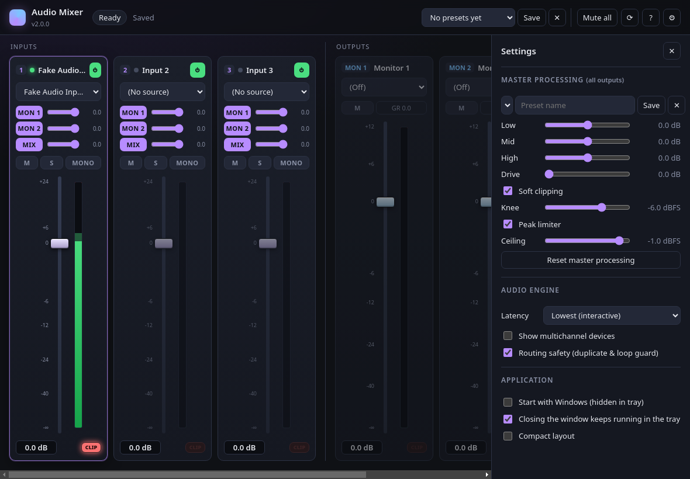

# Luna's Audio Mixer

A low-latency desktop mixer for Windows. Capture microphones, line inputs **or individual applications**, mix them on channel strips and route the result to up to three output devices (e.g. headphones, speakers and a virtual cable for streaming).



## Features

**Inputs (3 channel strips)**
- Source: any capture device **or a running application** (per-app capture via Windows WASAPI process loopback).
- Gain fader in dB, from -∞ to **+24 dB**.
- Mute, Solo, Mono sum, Enable.
- Three sends per strip (MON 1 / MON 2 / MIX), each with its own on/off and level.
- Peak + RMS meter with peak hold and a latching clip light.
- Each source remembers its own strip settings. Apps are remembered by exe name.

**Outputs (3 buses: Monitor 1, Monitor 2, Mixed Output)**
- Output device selector, fader up to +12 dB, mute.
- Peak + RMS meter, clip light and limiter gain-reduction readout.

**Master processing (all buses)**
- 3-band EQ (low shelf 180 Hz, peak 1.4 kHz, high shelf 5.6 kHz) with built-in and saved presets.
- Drive (post-mix boost, 0 to +12 dB).
- **Soft clipping**: a tanh knee, 4× oversampled, with an adjustable knee. It saturates peaks smoothly instead of hard-cutting them.
- **Peak limiter**: a 3 ms lookahead brickwall with an adjustable ceiling (default -1 dBFS).

**Robustness**
- Hot-plug: a missing device or app keeps its slot and reconnects automatically when it comes back (matched by name). Restarted apps are picked up again within about 5 s.
- Capture helper processes are always cleaned up: when a source is unused, and on reload, crash or quit.
- Settings are written atomically and migrated from every earlier version. An unreadable config is backed up, not lost.

**Workflow**
- Mix presets: save, recall and delete, with Ctrl+S and Ctrl+1–9.
- Keyboard shortcuts (press `?` in the app).
- Tray icon (show, mute all, quit), close-to-tray, start with Windows (hidden).
- Remembers the window size and position. Responsive layout and a compact mode.

## Signal flow

```
Input strip (devices and apps alike)
  source ─► stereo | mono-sum ─► gain (≤ +24 dB) ─► mute/solo ─┬─► meter
                                                               ├─► send MON 1 ─┐
                                                               ├─► send MON 2 ─┤
                                                               └─► send MIX ───┤
Output bus (×3)                                                                ▼
  Σ ─► EQ low/mid/high ─► drive ─► fader ─► soft clip ─► limiter ─┬─► meter
                                                                  └─► output device
```

The engine runs at 48 kHz, the same rate as app capture, so app audio isn't resampled. Every parameter change is ramped to avoid zipper noise and clicks.

## Keyboard shortcuts

| Keys | Action |
| --- | --- |
| 1 – 3 | Select input strip |
| ↑ / ↓ (Shift) | Nudge selected fader ±0.5 dB (±3 dB) |
| 0 | Reset selected fader to 0 dB |
| M / S / O / E | Mute / Solo / Mono / Enable selected input |
| Shift + M | Mute / unmute all outputs |
| Ctrl + S | Save preset |
| Ctrl + 1 – 9 | Load preset 1 – 9 |
| Ctrl + R, F5 | Refresh devices and applications |
| , | Settings |
| ? | Help |
| Esc | Close panel |

Faders also respond to the mouse wheel (Shift = coarse). Double-click a fader or its readout to return to 0 dB.

## Per-application capture

Running apps with a visible window appear in each input's **Applications** group. Selecting one captures only that process tree, using `AUDIOCLIENT_ACTIVATION_TYPE_PROCESS_LOOPBACK` through the native helpers in [`application-loopback`](https://github.com/WerdoxDev/application-loopback). The main process streams 16-bit / 48 kHz stereo PCM to the renderer. There, an AudioWorklet feeds it straight into the strip, holding about 30 ms of buffer (at most 120 ms).

- Requires **Windows 10 2004 (build 19041) or newer, x64**.
- Capturing doesn't mute the app on its normal output device.
- Apps that play audio from a windowless helper process are captured through the parent app's process tree.

## Requirements

- Windows 10/11 x64
- Optional: a virtual audio cable (e.g. VB-CABLE) to send the Mixed Output to OBS, Discord, etc.

## Development

```sh
npm install
npm start            # run in development (settings are stored in the repo folder)
npm test             # unit tests: config migration, DSP, limiter, PCM player, graph wiring
npm run check        # syntax check of every source file
npm run make         # build the Squirrel installer + zip into out/make
```

A headless smoke test boots the real app with a throwaway settings folder and takes a screenshot:

```sh
xvfb-run electron --use-fake-device-for-media-stream --use-fake-ui-for-media-stream scripts/smoke-main.js shot.png
```

### Project layout

```
src/
  main/        Electron main process
    index.js       window, tray, IPC, security, lifecycle
    config.js      config schema + migration (pure, unit-tested)
    store.js       atomic JSON persistence
    appCapture.js  per-app capture helper management
  preload/     sandboxed bridge (window.mixerAPI)
  renderer/    UI + audio engine (ES modules, no framework)
    app.js         state + controller
    devices.js     discovery, rebinding, routing-safety rules
    engine/        engine.js (graph), sources.js, worklets.js, meters.js, dsp.js
    ui/            mixer strips, faders/meters, settings, presets, shortcuts, toasts
test/          node:test suites
```

### Security

The renderer runs with `contextIsolation`, `sandbox` and no Node integration. A strict Content-Security-Policy is in place. Navigation, new windows and `<webview>` are blocked, and only the media permissions are granted. Every IPC handler checks its sender and arguments.

## Settings and migration

Settings live in `%APPDATA%/Audio Mixer/config.json` (`config.json` in the repo folder during development). Per-source strip memory lives in `deviceStates.json`. Config **v4** is migrated automatically from v1–v3:

- Linear volumes become dB.
- `overloadGain` becomes `driveDb`.
- Flat per-input fields become `sends`.
- Old presets and EQ presets carry over.

## Troubleshooting

- **No sound:** check that each output bus has a device selected (not *(Off)*), that the input's send buttons are lit, and that nothing is muted or soloed. A pulsing **SOLO** badge appears in the header when any input is soloed.
- **An option is greyed out:** hover it. Routing safety blocks using the same device twice and virtual-cable loops. You can turn this off in Settings.
- **Crackles:** set Settings → Audio engine → Latency to *Balanced* or *Safe*.
- **An app isn't listed:** it needs a visible window. Click ⟳ (or press Ctrl+R) after starting it.
- **SmartScreen warning on install:** the installer isn't code-signed. Choose *More info → Run anyway*.
